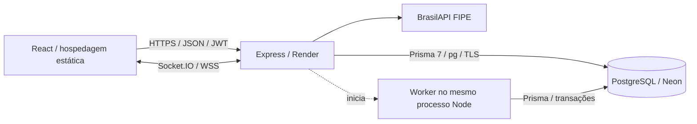

# Sistema de Leilões de Automóveis

Aplicação full stack desenvolvida para o desafio técnico **Elite Dev da Verzel**. Reúne gerenciamento de leilões, lances em tempo real, carteira virtual, liquidação e consultas públicas de transparência.

## Funcionalidades implementadas

- Autenticação JWT, perfis BIDDER e AUCTIONEER, proteção de rotas e revalidação de permissões no backend.
- Cadastro e edição de veículos, imagens por URL e preenchimento confirmado pela FIPE/BrasilAPI, com alternativa manual.
- Cadastro de leilões e lotes, publicação com confirmação, abertura automática e painel de resultados do leiloeiro.
- Sala de lances: veículo, valores, histórico paginado, situação do participante, contagem estimada com relógio do servidor, Socket.IO e reconexão.
- Carteira com saldo total, reservado e disponível; crédito **exclusivamente simulado**, local autorizado ou demonstração de produção com contas explicitamente autorizadas e teto acumulado.
- Reserva de saldo, lances com idempotência, prorrogação contra lances de última hora e liquidação transacional.
- Meus arremates, comprovante público compartilhável e auditoria pública com verificação da cadeia de eventos.
- Layout responsivo, interface em português brasileiro e temas claro/escuro.

## Tecnologias e arquitetura

Frontend: React 19, React Router, TypeScript, Vite, Tailwind CSS e Socket.IO Client. Backend: Node.js 24, Express 5, TypeScript, Prisma 7 com `@prisma/adapter-pg`, PostgreSQL, JWT, bcrypt e Socket.IO. Versões exatas estão nos manifests e lockfiles; a versão Node usada nas verificações está em [.node-version](.node-version).



- `frontend/src/services`: contratos, validação de respostas e integração HTTP/Socket.IO.
- `frontend/src/components` e `pages`: interface, estados de consulta, formulários e navegação.
- `backend/src/modules`: rotas, serviços de negócio e repositórios transacionais.
- `backend/src/workers`: abertura agendada e encerramento no worker existente, sem processo separado.
- `backend/prisma`: schema, configuração e histórico de migrações.
- `docs`: contratos e procedimentos específicos. Para publicação, use o [guia atual de deploy](docs/deploy.md); documentos antigos de migração temporal registram etapas históricas e não devem ser repetidos automaticamente.

## Instalação local

Pré-requisitos: Node.js **24.18.0**, npm, PostgreSQL 17 e acesso à BrasilAPI para consultas FIPE. Para instalação nova, disponibilize um banco local vazio `sistema_leiloes` antes de criar o schema. Comandos abaixo usam PowerShell na raiz do projeto. Em Linux, use `npm` no lugar de `npm.cmd` e os equivalentes de cópia do shell.

```powershell
cd backend
npm.cmd ci --include=dev
Copy-Item .env.example .env
```

Preencha `DATABASE_URL` e `JWT_SECRET` localmente, sem publicar seus valores. O segredo JWT precisa ter pelo menos 32 bytes aleatórios. Configure `FRONTEND_URL=http://localhost:5173`, `AUCTION_TEMPORAL_MODE=UTC_V2` e mantenha `ENABLE_SIMULATED_CREDITS=false`, salvo habilitação deliberada de uma demonstração local isolada.

Em **banco novo e vazio**, criar o schema é uma etapa administrativa separada. Após conferir o destino e autorizar essa criação:

```powershell
npm.cmd run prisma:migrate:deploy
```

Não executar migrações novamente em uma base restaurada só para tentar corrigir um erro de inicialização. Para banco existente, confirmar compatibilidade com UTC_V2 conforme o [guia de deploy](docs/deploy.md). Não usar reset ou `db push` sobre dados existentes.

```powershell
npm.cmd run prisma:generate
npm.cmd run dev
```

Em outro terminal, partindo da raiz:

```powershell
cd frontend
npm.cmd ci --include=dev
Copy-Item .env.example .env
npm.cmd run dev
```

Frontend: `http://localhost:5173`. API e Socket.IO: `http://localhost:3000`. Saúde: `GET /api/health`. O backend verifica compatibilidade temporal antes de abrir HTTP e iniciar o worker. A preparação desta documentação **não executa** as operações administrativas descritas acima.

## Build e execução compilada

| Projeto | Build | Execução / artefato |
| --- | --- | --- |
| Backend, em `backend/` | `npm.cmd run build` | `npm.cmd start` → `node dist/server.js` |
| Frontend, em `frontend/` | `npm.cmd run build` | publicar `dist/` em hospedagem estática |

O build backend gera o Prisma Client e compila TypeScript; não aplica migrações. `npm.cmd run preview` no frontend serve apenas para conferir o build localmente, não é o servidor recomendado para produção. A API inicia abertura e encerramento automáticos no mesmo processo, após aprovação do preflight UTC_V2.

## Testes

```powershell
# Em backend/, após gerar o Prisma Client:
npm.cmd run typecheck
npm.cmd test

# Em frontend/:
npm.cmd run typecheck
npm.cmd test
npm.cmd run build
```

Os testes comuns usam repositórios/HTTP/eventos simulados; os testes PostgreSQL são opt-in por variáveis `*_DATABASE_TESTS` e devem permanecer desabilitados fora de uma base de testes. Nunca apontar testes de integração para o Neon de demonstração/produção. Os testes de navegador usam Chromium quando disponível; configurar `CHROMIUM_PATH` se necessário. Um teste ignorado por ausência de navegador não comprova validação visual. `FIPE_LIVE_TESTS=1` é uma opção explícita de consulta FIPE real, não exigida pela suíte padrão.

## Uso e regras de negócio

1. O cadastro público cria **BIDDER**. O papel AUCTIONEER é administrado; o script `npm.cmd run user:promote -- EMAIL` exige substituir `EMAIL` pelo e-mail válido da conta local existente, ambiente local e confirmação interativa. Não funciona como promoção remota em produção.
2. O leiloeiro cadastra veículo, leilão DRAFT com início futuro e lotes válidos; depois confirma **Publicar leilão**. A publicação usa `/schedule` e resulta em SCHEDULED.
3. Com o backend ativo, o worker abre no início: `OPEN` na API, **Ao vivo** na interface. São revalidados geração, propriedade, prazo, lotes, histórico e auditoria; não se força abertura tardia após o término.
4. Somente BIDDER autenticado e elegível pode enviar lances. Valores monetários trafegam como strings decimais; saldo é reservado e as transações do banco protegem contra concorrência e repetição.
5. Lances aceitos dentro dos últimos dois minutos podem estender o prazo individual para garantir uma nova janela de dois minutos. O cliente mostra uma estimativa; o servidor decide aceitação e encerramento.
6. A liquidação confirma SOLD ou UNSOLD, movimentação financeira virtual e comprovante. O cliente não infere um arremate só porque o contador chegou a zero.
7. A edição depende de status, início ainda futuro, propriedade e ausência de histórico impeditivo. LEGACY permanece protegido; UTC_V2 não converte registros históricos.
8. O preço FIPE é referência. Anos especiais não são convertidos artificialmente em anos convencionais.
9. Auditoria pública verifica a cadeia de eventos; o histórico público de lances é uma consulta separada, não uma assinatura individual de todos os lances. Nenhuma tela pública divulga dados pessoais do vencedor.
10. Em produção, créditos simulados ficam desabilitados por padrão. Para avaliação, o responsável pode autorizar exclusivamente IDs de contas BIDDER fictícias com limite acumulado, conforme a [configuração de demonstração](docs/deploy.md#créditos-simulados-controlados-na-render). Novas contas não são autorizadas automaticamente.

## Deploy gratuito e limitações

O [guia de deploy](docs/deploy.md) contém os valores exatos de Render Web Service + Neon PostgreSQL + Render Static Site, variáveis, rewrite da SPA, CORS, Socket.IO, Prisma e preparação segura dos dados. Não há deploy ou URL pública validada nesta preparação.

A Render gratuita pode suspender a API após 15 minutos sem tráfego de entrada, incluindo HTTP e mensagens WebSocket. Durante a suspensão, o worker não abre nem encerra leilões; o serviço pode levar cerca de um minuto para voltar. É uma configuração para avaliação, não garantia de operação contínua. [Limitações oficiais](https://render.com/docs/free).

## Utilização de inteligência artificial

O desenvolvimento deste projeto contou com minha participação direta na programação, implementação de funcionalidades, definição das regras de negócio, estruturação do sistema, realização de testes e resolução de problemas encontrados durante o processo.

Durante o desenvolvimento, utilizei o Codex como ferramenta de apoio para análise e implementação de código, sugestões de melhorias, identificação e correção de erros, criação e ajustes de testes e organização da documentação.

O projeto foi desenvolvido de forma incremental, com acompanhamento das implementações, testes manuais utilizando o Postman, verificações automatizadas e validação das principais funcionalidades em ambiente local e na versão publicada.

A inteligência artificial contribuiu como ferramenta de suporte ao desenvolvimento, mas não substituiu minha participação prática na construção do sistema, nas decisões técnicas e na avaliação dos resultados.

## Situação da entrega

Funcionalidades implementadas e verificadas localmente. Pendem a configuração dos serviços gratuitos pelo responsável, preparação autorizada das contas fictícias, fornecimento privado das contas de avaliação e validação final no domínio publicado. Não existe seed remoto pronto; uma base vazia não possui usuário leiloeiro ou saldo de avaliação. O crédito simulado controlado exige habilitação explícita, lista de IDs e teto acumulado; não libera créditos para o público geral.
